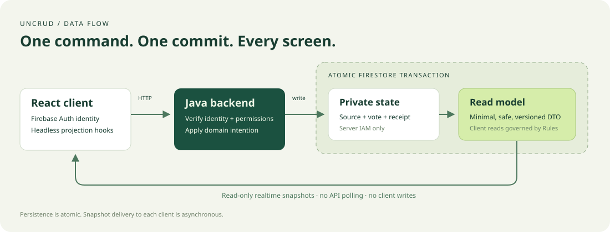

# UnCRUD

**Comandi in ingresso. Proiezioni realtime in uscita.** Il server applica le modifiche; i client osservano un read model persistente e sicuro attraverso listener Firestore.

[English](README.md) · [Guida locale](docs/getting-started.md) · [Architettura](docs/architecture.md) · [Skill](.agents/skills)



UnCRUD comprende librerie Java e TypeScript e uno starter poll funzionante per Cloud Run, Firebase Hosting, Cloud Firestore e Firebase Authentication. Usa CQRS con viste materializzate. Non è Event Sourcing, un event store, un CRUD automatico sul database o un framework grafico.

## Avvio locale

Servono **Java 25**, **Node 24.14 o successivo nella linea 24**, npm e un browser. Gradle e Firebase CLI sono gestiti dal progetto. Non occorrono account Google, chiavi, billing o progetti Firebase reali. La prima installazione scarica dipendenze ed emulatori; le esecuzioni successive usano le cache locali.

```bash
nvm use                  # se usi nvm; altrimenti seleziona Node 24
npm ci
npm run dev
```

Apri [il poll](http://127.0.0.1:5174) e una finestra privata per una seconda identità anonima Firebase. Vota o modifica il voto: entrambi gli schermi si aggiornano dai listener Firestore. [Emulator UI](http://127.0.0.1:4100) mostra i dati sintetici. Ctrl+C arresta i processi della sessione; una porta occupata causa l'arresto senza prendere il controllo di altri processi.

Porte su loopback: frontend `5174`, backend `8181`, Firestore `8180`, Auth `9199`, UI `4100`, hub `4401`, logging `4501`, websocket Firestore `9150`. Progetto locale fisso: `demo-uncrud`.

```bash
npx playwright install chromium  # una volta, per i test browser
npm run verify                  # build, unit, app generata, emulatori, Rules, E2E
```

La [guida locale](docs/getting-started.md) descrive controlli singoli, log, manutenzione ed errori frequenti; il [resoconto delle verifiche](docs/verification.md) riporta i risultati eseguiti.

## Uso server

I moduli si collegano nel build Gradle locale, senza pubblicare artefatti:

```groovy
implementation project(':backend:uncrud-spring-boot')
```

Controller espliciti verificano l'identità e delegano ai command handler. Esempio con il dominio dello starter:

```java
import uncrud.core.CommandHandler;
import uncrud.core.CommandReceipt;
import uncrud.poll.PollModels.CastVote;
import uncrud.poll.PollService;

// store è iniettato; identity arriva da FirebaseIdentity.require(authorization).
CommandHandler<CastVote, CommandReceipt> handler = new PollService(store);
CommandReceipt receipt = handler.handle(identity,
        new CastVote("weekend", "books", 0, "unique-command-123"));
```

`DocumentStore.transaction` accumula le scritture finché letture e builder delle viste sono terminati. `Idempotency.execute` salva la ricevuta nello stesso commit. `Projection<S,V>` costruisce un DTO esplicito dai dati privati. Il dominio sceglie il proprio schema. [Guida server](docs/server-client.md#server).

Il voto usa `POST /api/v1/polls/{pollId}/vote`, header `Authorization: Bearer <Firebase ID token>`, `Idempotency-Key` e JSON `{ "optionId": "books", "expectedVoteVersion": 0 }`. Risposta: `{ "commandId": "…", "versions": { "poll": 2, "vote": 1 } }`. I numeri sono illustrativi; i dati da visualizzare arrivano dalle proiezioni.

## Uso client

I pacchetti vengono risolti tramite npm workspaces, senza pubblicazione:

```tsx
import { createClient } from '@uncrud/client';
import { firebaseAuthSource, firestoreProjections } from '@uncrud/client/firebase';
import { UncrudProvider, useCommand, useProjection } from '@uncrud/react';

const session = firebaseAuthSource(auth);
const client = createClient({ endpoint: '/api/v1', auth: session });
const views = firestoreProjections(database);
const pollRef = views.document('pollViews/weekend', decodePoll, 'poll-v1');

// Dentro <UncrudProvider auth={session} client={client}>:
const poll = useProjection(pollRef);
const vote = useCommand<{ optionId: string; expectedVoteVersion: number }>('/polls/weekend/vote');
await vote.execute({ optionId: 'books', expectedVoteVersion: 0 });
// Mostra poll.data. vote.receipt conferma soltanto il commit.
```

Configura `auth` e `database` come istanze Firebase e fornisci un decoder che validi il tuo DTO. Gli hook distinguono caricamento, assenza, dati, cache ed errore; condividono i listener e li rimuovono al cleanup. Un cambio identità elimina i dati precedenti. `views.query` richiede ordinamento e limite 1–100; si legge con `useProjectionQuery`. [Guida client](docs/server-client.md#client).

## Struttura e moduli

```text
backend/             uncrud-core · uncrud-firestore · uncrud-spring-boot
frontend/packages/   @uncrud/client · @uncrud/react
starter/             backend Java · frontend React del poll
deploy/              Rules, indici, template Hosting e Cloud Run
.agents/skills/      undici skill di sviluppo e operatività
docs/                guide, mappa di estrazione, decisioni e diagrammi SVG
scripts/             avvio isolato, generatore di app e verifiche
tests/               TypeScript, Rules ed E2E con due client
.github/workflows/   CI locale e template cloud opzionale inattivo
```

## Garanzie e limiti

- Voto privato, conteggi privati, viste e ricevuta sono atomici. La consegna degli snapshot al browser è asincrona. Un errore HTTP può lasciare un esito **ignoto**: ripetere lo stesso input con la stessa chiave.
- Un voto modificabile per UID; le identità anonime non dimostrano persone uniche. Il contatore centrale è adatto al demo, con limiti di contesa a volumi elevati.
- La ricostruzione recupera viste assenti o obsolete dallo stato privato. Non ricalcola i conteggi autorevoli da tutti i voti, non rileva ogni corruzione con metadati invariati e non viene eseguita automaticamente.
- La v1 non include proiettori asincroni, membership multi-tenant, contatori distribuiti, retention delle ricevute o protezioni antiabuso da produzione.
- Le Rules negano scritture client e letture private. Admin SDK usa IAM e non è vincolato dalle Rules: l'autorizzazione server resta necessaria. Le Rules dello starter sono un prototipo testato per questi accessi, da rivedere quando l'app cambia.
- Build e test locali sono implementati; risorse cloud e proprietà dei namespace non sono predisposte né verificate. Template cloud da configurare e autorizzare esplicitamente; seed del demo solo locale.

## Agenti e passi successivi

[AGENTS.md](AGENTS.md) rende scopribili undici [skill](.agents/skills): inizializzazione, sviluppo backend/client, test, credenziali sviluppatore, setup GCP, Cloud Run, Hosting, Firestore, Firebase Auth e CI/CD. Comprendono comandi, diagnostica, criteri di stop e fonti ufficiali.

```bash
node scripts/init-app.mjs --name=my-app --dest=/percorso/assoluto/parent/my-app --dry-run
node scripts/init-app.mjs --name=my-app --dest=/percorso/assoluto/parent/my-app
```

La destinazione deve essere vuota e il parent esistere. Nessuna risorsa cloud viene creata. Il [setup cloud](docs/cloud-setup.md) e la [guida credenziali](docs/agent-auth.md) spiegano quali azioni richiedono autorizzazione: progetti/database, billing, API, IAM, deploy, Rules e pubblicazione dei pacchetti.

Vedi [sicurezza](docs/security.md), [mappa di estrazione](docs/extraction-map.md), [release](docs/releasing.md) e [contributi](CONTRIBUTING.md). Licenza [Apache-2.0](LICENSE).
