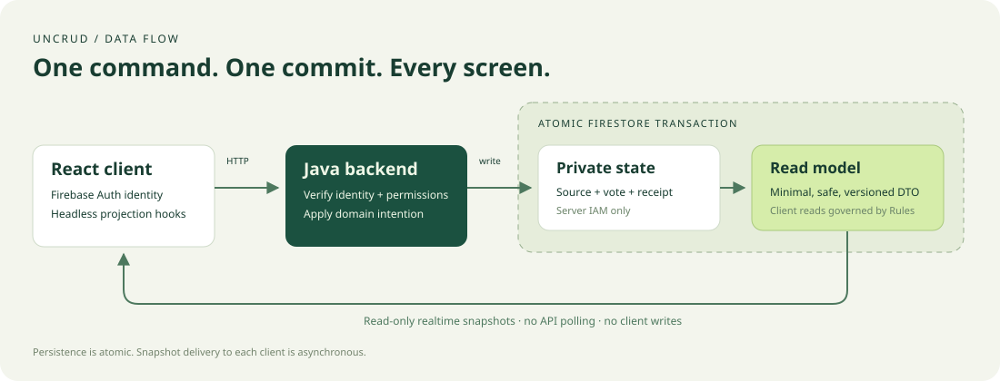

# UnCRUD

**Commands in. Realtime projections out.** Build applications where the server owns mutations and clients observe a safe, persistent read model through Firestore listeners.

[Italiano](README.it.md) · [Local guide](docs/getting-started.md) · [Architecture](docs/architecture.md) · [Agent skills](.agents/skills)



UnCRUD is a small Java + TypeScript toolkit and a working poll starter for Cloud Run, Firebase Hosting, Cloud Firestore and Firebase Authentication. It uses CQRS with materialized views. It is not Event Sourcing, an event store, an automatic database CRUD API, or a UI framework.

## Run locally

Requires **Java 25**, **Node 24.14+ within Node 24**, npm and a browser. Gradle and Firebase CLI are project-managed. No Google account, service-account file, billing or real Firebase project is needed. The first installation downloads dependencies and emulator binaries; subsequent runs use their local caches.

```bash
nvm use                  # if you use nvm; otherwise select Node 24 yourself
npm ci
npm run dev
```

Open [the poll](http://127.0.0.1:5174) and a private browser window for another anonymous Firebase identity. Submit or change a vote: both screens update from Firestore. Inspect synthetic data at [Emulator UI](http://127.0.0.1:4100). Ctrl+C shuts down this run. Occupied ports cause a failure; UnCRUD never takes over another process.

Local endpoints: frontend `5174`, backend `8181`, Firestore `8180`, Auth `9199`, UI `4100`, emulator hub `4401`, logging `4501`, Firestore websocket `9150`. All bind to loopback. The local project is always `demo-uncrud`.

```bash
npx playwright install chromium  # once, for browser tests
npm run verify                  # build + unit + generated-app + emulator + Rules + E2E
```

See [getting started](docs/getting-started.md) for individual checks, logs, maintenance and troubleshooting, and the dated [verification record](docs/verification.md) for executed results.

## Server use

Use Gradle project dependencies while the modules are unpublished:

```groovy
implementation project(':backend:uncrud-spring-boot')
```

Write explicit controllers and domain handlers. The starter implements the public contracts like this:

```java
import uncrud.core.CommandHandler;
import uncrud.core.CommandReceipt;
import uncrud.core.Identity;
import uncrud.poll.PollModels.CastVote;
import uncrud.poll.PollService;

// store is injected; identity is returned by FirebaseIdentity.require(authorization).
CommandHandler<CastVote, CommandReceipt> handler = new PollService(store);
CommandReceipt receipt = handler.handle(identity,
        new CastVote("weekend", "books", 0, "unique-command-123"));
```

`DocumentStore.transaction` stages typed writes until all reads and projection builders complete. `Idempotency.execute` records the receipt in that transaction. `Projection<S,V>` builds an explicit display DTO from private state. No domain schema is imposed by the library. [Server development guide](docs/server-client.md#server).

The poll endpoint is `POST /api/v1/polls/{pollId}/vote`, with `Authorization: Bearer <Firebase ID token>`, `Idempotency-Key`, and JSON `{ "optionId": "books", "expectedVoteVersion": 0 }`. It returns `{ "commandId": "…", "versions": { "poll": 2, "vote": 1 } }`, not the result screen's data. Versions in examples are illustrative.

## Client use

The workspace packages are consumed locally, without npm publication:

```tsx
import { createClient } from '@uncrud/client';
import { firebaseAuthSource, firestoreProjections } from '@uncrud/client/firebase';
import { UncrudProvider, useCommand, useProjection } from '@uncrud/react';

const session = firebaseAuthSource(auth); // configured Firebase Auth instance
const client = createClient({ endpoint: '/api/v1', auth: session });
const views = firestoreProjections(database); // configured Firestore instance
const pollRef = views.document('pollViews/weekend', decodePoll, 'poll-v1');

// Inside <UncrudProvider auth={session} client={client}>:
const poll = useProjection(pollRef);
const vote = useCommand<{ optionId: string; expectedVoteVersion: number }>('/polls/weekend/vote');
await vote.execute({ optionId: 'books', expectedVoteVersion: 0 });
// Render poll.data. vote.receipt only confirms the command commit.
```

Supply a validating decoder for your own projection shape. Hooks distinguish loading, missing, ready, cached and error states; they share subscriptions and clean up on unmount. Identity changes clear previous data. `views.query` supports explicit ordering, filters and a limit of 1–100; `useProjectionQuery` consumes it. [Client guide](docs/server-client.md#client).

## Packages and layout

```text
backend/             uncrud-core · uncrud-firestore · uncrud-spring-boot
frontend/packages/   @uncrud/client · @uncrud/react
starter/             Java poll backend · React poll frontend
deploy/              Rules, indexes, Hosting and Cloud Run templates
.agents/skills/      eleven development and operations skills
docs/                guides, extraction map, decisions, SVG diagrams
scripts/             isolated local runner, app generator and checks
tests/               TypeScript, Rules and two-client browser tests
.github/workflows/   local CI and inert optional cloud workflow template
```

## Guarantees and limits

- Private vote, private counts, views and receipt commit atomically. Browser delivery is asynchronous. Failed HTTP delivery can leave an **unknown outcome**: retry the same input and idempotency key.
- One mutable vote per Firebase UID; anonymous identities do not establish unique people. The aggregate document is intended for a small demo, not a high-volume global voting service.
- Missing/stale views can be rebuilt from private state. Reconciliation does not recalculate authoritative counts from the entire vote history, detect arbitrary corruption with unchanged metadata, or run automatically.
- V1 has no asynchronous projector, tenant membership system, sharded counters, receipt retention policy or production abuse protection. Add application-specific authorization and limits before broader use.
- Client writes and private reads are denied by Rules; the Admin SDK bypasses Rules and relies on IAM plus server authorization. These are prototype starter Rules tested against the supplied access patterns; review them when changing your app.
- Builds and local tests are implemented. Cloud resources and namespace ownership are not provisioned or verified. Cloud templates are examples requiring explicit configuration and authorization. The sample seed is local only.

## Agents and next steps

Read [AGENTS.md](AGENTS.md). Eleven [skills](.agents/skills) cover initialization, server/client development, local testing, developer credentials, GCP setup, Run, Hosting, Firestore, user Auth and CI/CD. They include concrete commands, diagnostics, stop conditions and official references.

Generate an independent copy without cloud side effects:

```bash
node scripts/init-app.mjs --name=my-app --dest=/absolute/empty/parent/my-app --dry-run
node scripts/init-app.mjs --name=my-app --dest=/absolute/empty/parent/my-app
```

For cloud setup, start with [the checklist](docs/cloud-setup.md) and [agent authentication](docs/agent-auth.md). Creation of projects/databases, billing, APIs, IAM, deploys, rules changes and package publication require separate authorization.

See [security](docs/security.md), [extraction map](docs/extraction-map.md), [release policy](docs/releasing.md) and [contributing](CONTRIBUTING.md). Licensed under [Apache-2.0](LICENSE).
