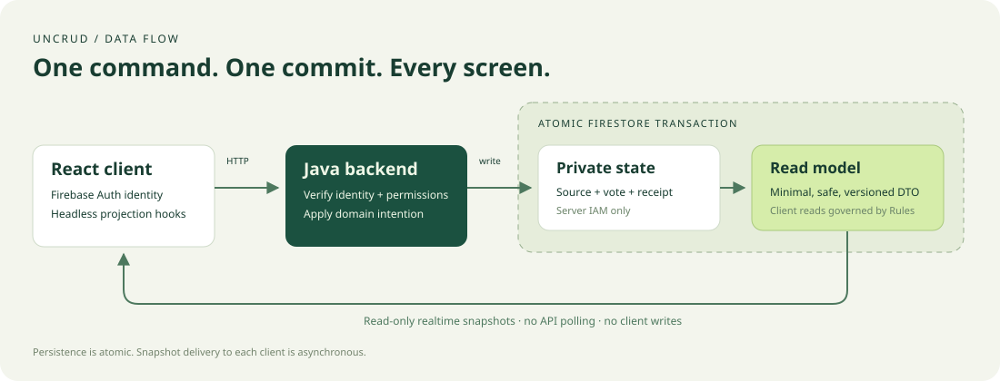
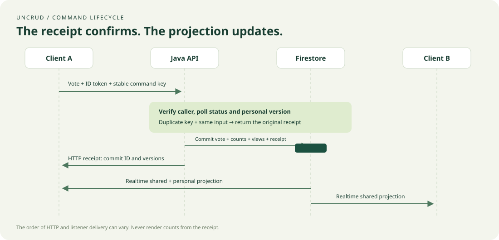
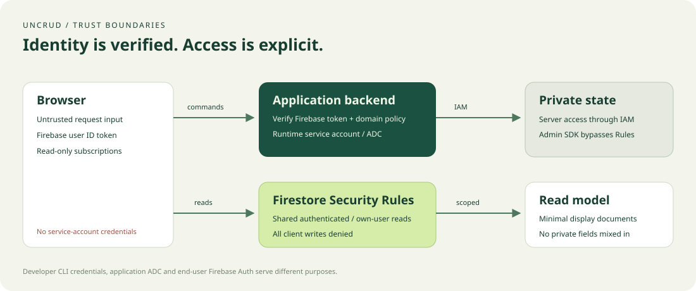

# Architecture

UnCRUD implements CQRS with materialized Firestore read models. HTTP commands express intentions; application handlers authenticate, authorize and update private state. Projection builders create minimal client DTOs. Clients subscribe to these DTOs and never mutate backend-owned documents. There is no event store or replay of business commands.

## Command and projection contract

`Command<R>` and `CommandHandler<C,R>` describe application behavior. `Identity` represents an already verified Firebase UID. A `DocumentKey<T>` identifies a typed document; schemas and paths belong to the application. `DocumentStore.Transaction` reads private state and stages writes. `Projection<S,V>` is a pure mapping that may read other dependencies through the same transaction.

The Firestore adapter flushes staged writes only after the callback returns. Firestore can rerun the callback, so builders and handlers must have no network requests, messages, logging of business effects, or mutation of external state inside it. Native transactions provide concurrency control; no client-side lock is assumed. See the [Firestore transaction contract](https://firebase.google.com/docs/firestore/manage-data/transactions).

The adapter caps staged writes at 400 and serialized document JSON at 900,000 bytes as conservative application guards. These are not a substitute for Firestore's physical document, request-size, index or transaction limits. A native limit violation fails the transaction atomically; growing data requires child documents or bounded operations.

## Poll data flow

| Path | Role | Browser access |
| --- | --- | --- |
| `privatePolls/{pollId}` | Private authoritative options, status, aggregate counts and version | None |
| `privatePolls/{pollId}/votes/{uid}` | One current private vote and personal version per UID | None |
| `privateCommands/{uidHash}/receipts/{operationKeyHash}` | Payload digest + committed receipt | None |
| `pollViews/{pollId}` | Title, bounded options, counts, projection metadata | Authenticated read |
| `userPollViews/{uid}/polls/{pollId}` | Own chosen option and metadata | Owner read |

The server reads the receipt, poll and previous vote; verifies open status, valid option and expected personal version; updates counts by subtracting the old contribution and adding the new one; builds views; stages all writes including the receipt. No-op votes keep the current versions. Collection growth creates documents, not arrays.

Idempotency keys are scoped by UID and operation (which includes poll ID); their stored payload digest includes the option and expected version. Identical retries return the original receipt even after later commands. Reusing a key with a different payload returns `409`. Different users have independent personal versions. Two conflicting commands from one user cannot both apply against the same expected version.

## Consistency and recovery

Private state and views commit together. Observers of different documents can still receive their callbacks at different times: **atomic persistence is not synchronized rendering across listeners**. Receipts contain `poll` and `vote` versions; the UI waits for its personal projection version before allowing the next mutation. It never copies response data into the read model.

`ProjectionMeta` contains `sourceVersion`, `schemaVersion` and epoch-millisecond `updatedAt`. Wall-clock time is diagnostic, not an ordering mechanism. Reconciliation compares metadata with the current source inside a fresh transaction. It diagnoses current/missing/stale/ahead/orphaned/absent states, rebuilds missing/stale views and deletes an explicitly checked orphan. It refuses to downgrade a view ahead of the source or supported schema. Scans use bounded pages and cursors; each item is reread before repair.

The supplied CLI scans existing private polls and votes. It cannot discover every orphan whose source no longer exists, detect a wrong payload whose metadata is unchanged, or recalculate authoritative counts from all votes. There is no scheduled reconciliation or asynchronous projector. Adding one requires a separate design for durable delivery, retries, ordering and lag monitoring.

Receipts currently have no automatic retention. Removing a receipt weakens replay protection for the affected key. Decide a retry window, archival and deletion policy before operating long-lived applications; never silently enable TTL.

## Client lifecycle

The pure TypeScript package owns HTTP commands, auth contracts and a shared external projection store. Its Firebase subpath adapts SDK Auth and Firestore without coupling the core package to React. React bindings use `useSyncExternalStore` and headless hooks.

Cache keys include Auth identity, resource identity, database instance, query and decoder ID. A resource has one SDK listener while at least one consumer is mounted. The last consumer unsubscribes. Identity/query changes discard old snapshots; stopped generations ignore late callbacks. Firebase manages transient reconnection. Terminal errors surface to callers without an infinite permission-error retry loop; remount/recreate a resource after resolving the cause. Cache metadata reports cached data, not proof of a healthy connection. The starter waits for server-confirmed snapshots before mutation.

HTTP refreshes a rejected Firebase token once. It does not automatically repeat uncertain network/5xx outcomes. The error preserves the command ID so a caller can retry the same body and key. A timeout or abort can occur after commit, and is not a rollback. Auth changes abort outstanding HTTP work and clear hook state.

## Security and deployment

Rules protect client reads and prohibit client writes. Admin/server SDK access uses IAM and bypasses Rules; every handler must perform authorization. The public Cloud Run invocation strategy accepts network traffic but requires Firebase Auth on protected APIs. Hosting rewrites preserve the `/api` path and do not replace backend authorization. CORS is an origin policy, not authentication.

Runtime cloud access uses ADC from the attached service account, with no downloaded key. CI uses GitHub OIDC/WIF. Local mode requires a demo project and both loopback emulators; cloud mode refuses emulator environment variables. See [security](security.md), [cloud setup](cloud-setup.md) and [decisions](decisions/0001-atomic-projections.md).
