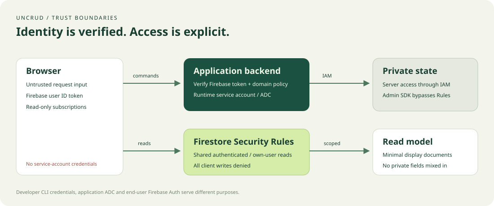

# Security boundaries

## Threat boundaries

Treat the browser, request body, UID claims outside verified tokens and requested document paths as untrusted. Protected commands verify Firebase ID tokens using the configured project, then enforce application policy. The starter derives identity from the token, accepts only bounded vote input, checks poll status and personal version, and never accepts a target user from the caller.

The shared view contains only poll labels/counts; voter identities and command receipts remain private. Personal views contain only one user's selection and metadata. Rules deny private reads and every client write, including requests with an `admin` claim. Owner restrictions use the verified Firebase UID. Queries must be bounded and compatible with Rules.

I've set up prototype Security Rules to keep the data in Firestore safe. They are designed to be secure for authenticated poll reads, owner-only personal views, and complete denial of client writes and private reads. However, you should review and verify them before broadly sharing your app. If you'd like, I can help you harden these rules.

This starter's Rules are exercised with the emulator and are not an audit of an application you later build. Admin SDK/server access bypasses these Rules. Restrict runtime IAM, protect each new controller and operator entrypoint, and test negative cases. Never expose a generic administrative Firestore API.

## Environments and secrets

Local mode requires `demo-uncrud` and both loopback emulators. Cloud mode requires an explicit non-demo project and refuses emulator variables. Use separate projects/identities for DEV and PROD, explicit CLI flags, and protected CI environments. Token audience checks prevent an identity from a different Firebase project being accepted by the backend.

No service-account keys belong in source, browser bundles, chat or container layers. Use attached workload credentials on Cloud Run and OIDC/WIF in CI. Human CLI login, SDK ADC and user Firebase Auth are distinct. Do not log Authorization headers, request tokens, credential files or sensitive payloads. App errors expose stable codes and safe messages. Existing starter access logging does not log request bodies/tokens; review logging middleware before adding it.

CORS is an explicit allowlist and not an authorization mechanism. Hosting rewrites provide same-origin routing, not proof of identity. HTTPS is required in cloud. The health endpoint is intentionally public and exposes no project/credential details. Anonymous Auth prevents unauthenticated access but is not rate limiting, unique-person enforcement or abuse protection.

## Tenancy, scaling and retention

The demo is a single shared authenticated poll space with per-user views. It does not implement tenant membership. For a tenant application, scope private and projected paths, queries, receipt identity and server authorization consistently; membership must come from trusted state/claims, and Rules must enforce the same boundary. Include cross-tenant negative tests before enabling the feature. Do not make a projection public merely because a UI reads it.

Private poll counts are maintained transactionally with per-user current votes. The central poll document is a contention point. There are no sharded counters, rate limits, App Check enforcement, audit-retention policy or automatic user deletion. Receipts are separate growing documents with no automatic TTL. Define sensitive-data handling, retention and deletion (private vote plus personal view and receipts as needed) for the actual application before production. Do not infer an applicable privacy policy from this demo.

Schema migrations must be bounded, versioned and recoverable. Back up sources before approved cloud migrations; restore into an isolated target first. Reconciliation repairs derived views from current private state and cannot recover deleted authoritative data. Metadata checks do not detect arbitrary same-version corruption.

## Reporting

Do not post tokens, credentials, user data or exploitable details in public issues. Contact the repository owner through a verified private channel, or use a private GitHub vulnerability report if the owner has enabled it. No dedicated security address is claimed by this repository. Include affected version, reproducible synthetic steps and impact; coordinate disclosure privately.
